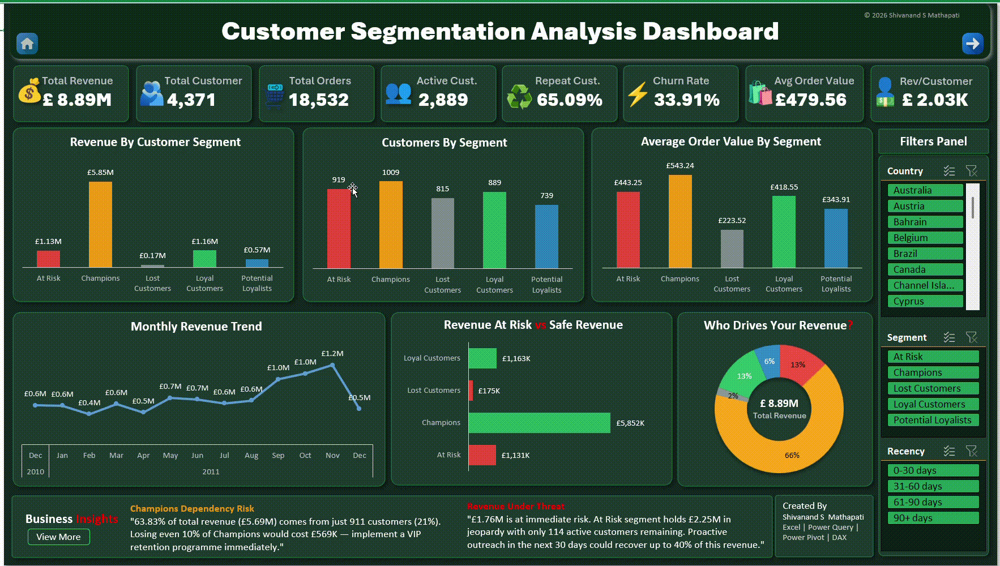
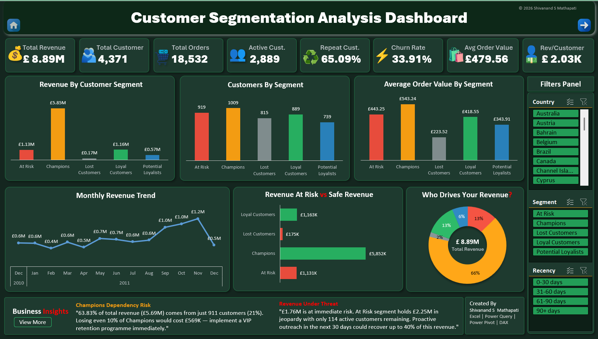
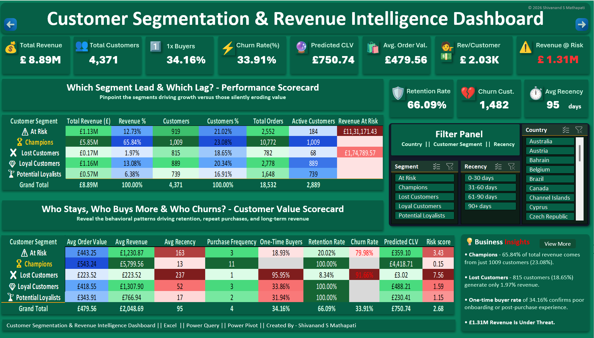

<div align="center">

# 📗 Customer Segmentation Analysis — Excel Dashboard

### End-to-end RFM customer segmentation built entirely in Excel, Power Query, Power Pivot & DAX 

[](https://www.microsoft.com/en-us/microsoft-365/excel)
[](#-etl--data-transformation)
[](#-rfm--segmentation-logic)
[](#️-data-model)
[](#)


</div>

---

## 📑 Table of Contents

- [Overview](#-overview)
- [Business Problem & Objective](#-business-problem--objective)
- [Key Features](#-key-features)
- [Dashboard Preview](#️-dashboard-preview)
- [Data Model](#️-data-model)
- [RFM & Segmentation Logic](#-rfm--segmentation-logic)
- [ETL / Data Transformation](#-etl--data-transformation)
- [Tech Stack](#️-tech-stack)
- [Repository Structure](#-repository-structure)
- [Key Findings](#-key-findings)
- [Root Causes & Caveats](#-root-causes--caveats)
- [Recommendations & Actions](#-recommendations--actions)
- [Related Projects](#-related-projects)
- [Author](#-author)
- [License](#-license)

---

## 📌 Overview

This project analyzes 13 months of transaction data from a UK-based online retailer using **RFM (Recency, Frequency, Monetary) segmentation** — built entirely inside **Microsoft Excel**, using **Power Query** for ETL, a **Power Pivot star schema** for the data model, and **DAX** for all scoring and KPI logic. It's the original, Excel-native version of a project also rebuilt in Power BI and SQL Server, all three sharing the same dataset, the same RFM methodology, and — after cross-checking all three against each other — closely matching final numbers.

| | |
|---|---|
| 🗂️ **Dataset** | Online Retail (UCI), 13 months, Dec 2010 – Dec 2011 |
| 💰 **Total Revenue** | £8.89M gross / £8.28M net |
| 👥 **Total Customers** | 4,371 |
| 📦 **Total Orders** | 18,532 |
| 🎯 **Methodology** | RFM Scoring (quintile) → 5-Segment model via DAX |
| 🗃️ **Data Model** | Star schema, 5 tables, fully relational (Power Pivot) |

---

## 🧩 Business Problem & Objective

**Business problem:** The company wants to understand customer behavior, purchasing patterns, and revenue contribution in order to improve retention and maximize revenue. Management needs a data-driven way to quickly answer:
- Which customers generate the most revenue?
- Which customer segments are most valuable?
- Which customers are at risk of churning?
- How frequently do customers purchase?
- How does customer value vary across segments?
- Where do potential growth opportunities exist?

**Objective:** Analyze customer transaction data using RFM methodology to segment customers by purchasing behavior, measure customer lifetime value (CLV), detect customers at risk of churn, and enable targeted retention and marketing strategies.

---

## ✨ Key Features

- **Full ETL pipeline in Power Query (M code)** — raw invoice data cleaned and transformed before ever reaching the data model
- **A proper Power Pivot star schema** — 5 related tables, not a single flat sheet, enabling efficient segment, country, and time-based analysis
- **RFM quintile scoring in DAX** — Recency, Frequency, and Monetary each scored 1–5, combined into a 5-segment classification (Champions, Loyal Customers, Potential Loyalists, At Risk, Lost Customers)
- **Two dedicated dashboards** — a chart-based Segment Performance Dashboard and a scorecard-style Customer Intelligence Dashboard, both slicer-driven
- **A dedicated EDA sheet** — pivot-table breakdowns across segment, country, product, recency, and time, feeding the dashboard visuals
- **A full Business Insights & Actions page** — every data finding paired with a business interpretation and a concrete recommended action
- **Cross-validated against two other tool builds** — the same dataset and RFM methodology were independently rebuilt in Power BI and SQL Server, and key numbers (Champions revenue, top customers, net revenue) match closely across all three

---

## 🖥️ Dashboard Preview

> 📂 Open the `.xlsx` file and navigate to the **📊 Customer_Segmentation_Dashboard** sheet to interact with the full dashboard including slicers and dynamic charts.  
> 📌 The dashboard provides an interactive, segment-level view of each segment performance.  
> Use slicers to dynamically filter data by Country, Recency & Segment.


### 🔹 Live Dashboard Preview


### 🔹 Customer Segmentation Analysis Dashboard


### 🔹 Customer Segmentation & Revenue Intelligence Dashboard



---
## 🖥️ Worksheets

| Sheet | Contents |
|---|---|
| 🏠 **Project Overview** | Business problem, objective, tools used, analytical pipeline, data model summary |
| 📊 **Segment Performance Dashboard** | Chart-based view of segment performance (bar, line, and doughnut charts) |
| 👥 **Customer Intelligence Dashboard** | Scorecard-style view of customer-level KPIs and segment detail |
| 💡 **Business Insights & Actions** | Data Finding → Business Insight → Strategic Action, across 13 focus areas |
| 🎯 **KPI Analysis** | 16 headline KPI cards: Revenue, Orders, Customers, Churn, Retention, CLV, Segment counts, and more |
| 🔍 **EDA** | Pivot-table breakdowns: revenue/customers by segment, by country, by recency, by month, top customers, R-Score × F-Score distribution |
| 🧩 **Data Model** | Star schema relationship diagram description |

---

## 🗃️ Data Model

A **star schema with 4 tables**, built in Power Pivot:

- **Fact table** — one row per invoice line item (541,909 raw rows)
- **Customer dimension** — one row per customer, with RFM scores and Segment
- **Country dimension**
- **Calendar (Date) dimension** — powers all month/quarter/time-based pivots and slicers

> Designed to enable efficient customer segmentation, revenue analysis, and time-based insights using Power Pivot — rather than relying on a single flat worksheet.

---

## 🎯 RFM & Segmentation Logic

Every customer is scored 1–5 on **Recency**, **Frequency**, and **Monetary** value using quintile-based DAX measures in Power Pivot, then classified into one of 5 segments:

| Segment | Customers | Revenue | Revenue % | Avg Order Value |
|---|---:|---:|---:|---:|
| 🏆 Champions | 1,009 | £5.85M | 65.84% | £543.24 |
| 💎 Loyal Customers | 889 | £1.16M | 13.08% | £418.55 |
| 🌴 Potential Loyalists | 739 | £566.77K | 6.38% | £343.91 |
| ⚠️ At Risk | 919 | £1.13M | 12.73% | £443.25 |
| ❌ Lost Customers | 815 | £174.79K | 1.97% | £223.52 |

> Champions make up just 23.1% of the customer base but drive 65.84% of total revenue — the same Pareto-style concentration independently confirmed in both the Power BI and SQL Server versions of this analysis.

---

## 🔄 ETL / Data Transformation

Data is cleaned and shaped entirely in **Power Query**, using M code, before loading into the Power Pivot data model:

- Raw invoice data ingested and cleaned (nulls, invalid values, cancellations handled)
- Split into a star schema (fact + customer/product/country/date dimensions)
- RFM values calculated and scored via DAX once inside the model
- Dynamic DAX measures power every KPI card — Total Revenue, Churn Rate, Retention Rate, CLV, Revenue at Risk, Safe Revenue, and more

---

## 🛠️ Tech Stack

| Tool | Purpose |
|---|---|
| **Microsoft Excel** | Workbook, dashboards, PivotTables, slicers |
| **Power Query (M code)** | Data ingestion, cleaning, and transformation |
| **Power Pivot** | Star schema data model |
| **DAX** | RFM scoring, segmentation logic, and all KPI measures |

---

## 📁 Repository Structure

```
Customer-Segmentation-Excel/
│
├── dashboard/
│   └── Customer_Segmentation_Dashboard_Full.xlsx   # Main workbook
├── raw data/
│   └── Online_Retail.xlsx                          # Source dataset
├── images/
│   └── dashboard-preview.png
└── README.md
```

---

## 🧩 Key Findings

- **Champions (1,009 customers, 23.1% of the base) generate 65.84% of total revenue** (£5.85M) — a concentration pattern confirmed independently across all three versions of this project
- **Churn rate stands at 33.91%** (1,482 of 4,371 customers with no purchase in 90+ days)
- **34.16% of customers made only one purchase** and never returned, despite repeat customers generating the large majority of revenue
- **£1.31M in revenue sits with At Risk and Lost Customers** combined, against £7.01M in Safe Revenue (Champions + Loyal Customers)
- **The United Kingdom dominates revenue** at £7.29M (81.97% of the total top-10-country revenue), far ahead of the next-largest market, the Netherlands (£285.45K)
- **Net revenue (£8.28M) is 6.85% below gross revenue (£8.89M)** once returns are accounted for

## 🔍 Root Causes & Caveats

- **December 2011 appears to show a sharp revenue decline** (£341.54K vs £1.13M in November) — this reflects the dataset ending 9 December 2011, a partial month, rather than a genuine seasonal drop
- **Two top-10 customers by revenue (IDs 16446 and 12346) show bulk-order transaction patterns** rather than typical repeat-purchase behavior — worth manually verifying before enrolling them in a standard VIP retention programme, a finding also confirmed independently in the SQL Server build of this project

## ✅ Recommendations & Actions

| # | Recommendation |
|---|---|
| 1 | Launch a VIP retention programme for the Champions segment |
| 2 | Deploy a win-back campaign for Lost Customers, prioritized by historical spend |
| 3 | Build a first-purchase nurture sequence targeting the 34.16% one-time-buyer rate |
| 4 | Run a 90-day conversion sprint for Potential Loyalists |
| 5 | Set a 90-day recency alert trigger to catch disengagement early |
| 6 | Footnote December 2011 as a partial month in all trend reporting |
| 7 | Manually verify CustomerIDs 16446 and 12346 before standard VIP treatment |

---

## 🔗 Related Projects

Part of a multi-tool Customer Segmentation portfolio, built on the same Online Retail dataset:

| Project | Tool | Link |
|---|---|---|
| 📊 Customer Segmentation Analysis (this same dataset) | Power BI | [github.com/shivanand-Mathapati-Analyst/powerbi-customer-segmentation-analysis-project](https://github.com/shivanand-Mathapati-Analyst/powerbi-customer-segmentation-analysis) |
| 🗄️ Customer Segmentation Analysis (this same dataset) | SQL Server | [github.com/shivanand-Mathapati-Analyst/sql-customer-segmentation-analysis-project](https://github.com/shivanand-Mathapati-Analyst/sql-customer-segmentation-analysis) |

Also part of a broader retail analytics portfolio built on the Superstore dataset:

| Project | Tool | Link |
|---|---|---|
| 📊 Superstore Sales Analysis | Power BI | [github.com/shivanand-Mathapati-Analyst/powerbi-sales-analysis-project](https://github.com/shivanand-Mathapati-Analyst/powerbi-superstore-sales-analysis) |
| 🗄️ Superstore Sales Analysis | SQL Server | [github.com/shivanand-Mathapati-Analyst/sql-superstore-sales-analysis](https://github.com/shivanand-Mathapati-Analyst/sql-superstore-sales-analysis) |
| 📗 Superstore Sales Analysis | Excel | [github.com/shivanand-Mathapati-Analyst/excel-superstore-sales-analysis](https://github.com/shivanand-Mathapati-Analyst/excel-superstore-sales-analysis) |

---

## 👤 Author

**Shivanand S. Mathapati**

- 🌐 Portfolio: 
- 💼 LinkedIn: 
- ✉️ Email: 

---

## 📄 License

This project is licensed under the **MIT License** — feel free to use the dashboard structure and DAX patterns for your own learning or portfolio projects. See [LICENSE](LICENSE) for details.

---

<div align="center">

⭐ **If you found this project useful, consider giving it a star!** ⭐

</div>


